# Rosie card kit (beta)

> **BETA.** This kit works and is in daily use, but it is still evolving. Feedback, bug reports and ideas are welcome: [@papagatorz](https://x.com/papagatorz) on X or gator@mail.grokbot.com.

The kit writes standard MIME email (.eml) with the art inline, so it works with any mail system; Rosie can send through Gmail, Outlook, or the bot's own Grok Bot inbox.

Rosie is a Grok Bot that designs greeting cards where **the email itself is the card**. There's no "click here to view your e-card" link and no card website. The birthday (or thank-you, or just-because) card arrives as an email body that looks like a card, with a plain-text twin for mail apps that don't show HTML.

This repo is the card kit Rosie uses: four email-safe HTML templates, plus small Python tools to fill them, lint them and render previews. You can use it on its own with any mail sender that accepts HTML and plain-text parts.

## The four styles

Each preview below is filled with the example values in [`previews/example-values.json`](previews/example-values.json) ("Alex", from "Sam"). The left image has no art; the right image has the example art.

| Style | Templates | Look |
|---|---|---|
| Funny | `templates/funny.html`, `funny.txt` | Off-white card with a thin tan border, emoji strips at the top and bottom, a tan badge, a big navy uppercase headline, and the name in green. Loud and playful. |
| Heartfelt | `templates/heartfelt.html`, `heartfelt.txt` | Soft cream card, serif lettering, one 🌷 accent, rose-colored name. Warm, no jokes. |
| Kid/Fun | `templates/kidfun.html`, `kidfun.txt` | Bright yellow border, big emoji strips (🎈🦕🎂🦖), very large friendly type. |
| Classic | `templates/classic.html`, `classic.txt` | Cream card, navy lettering and border, gold rules, a modest 🎂 ✨ 🎉 header. A good default. |

### Funny

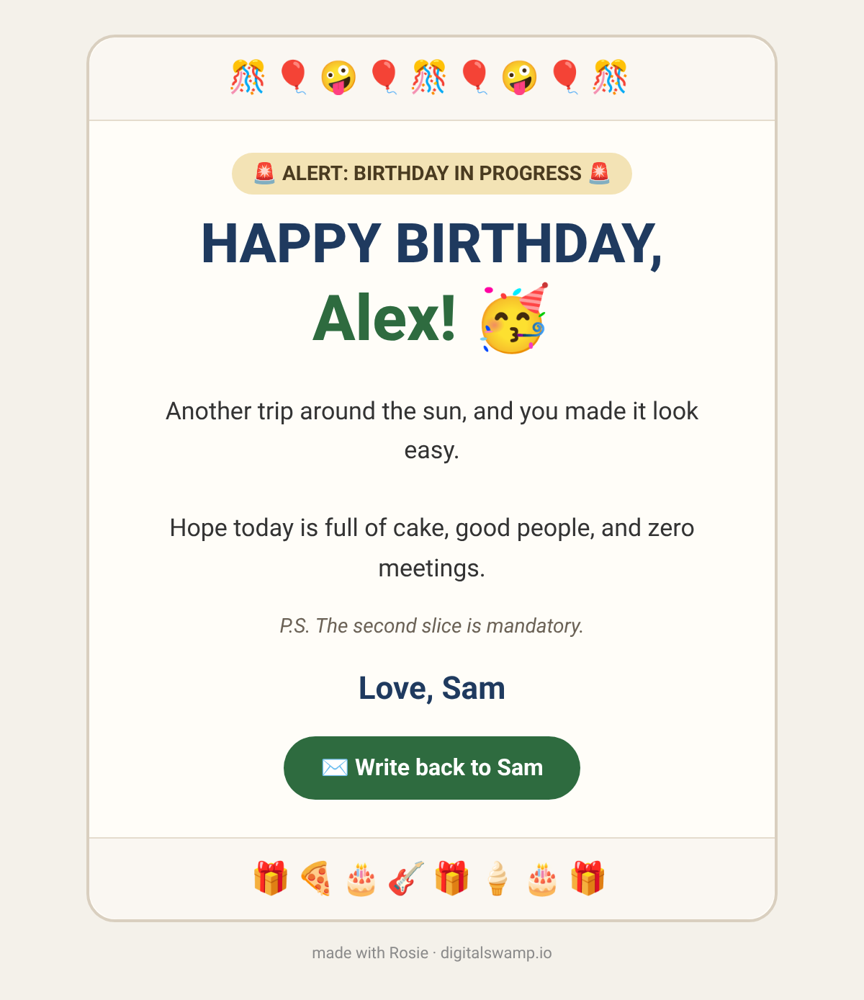 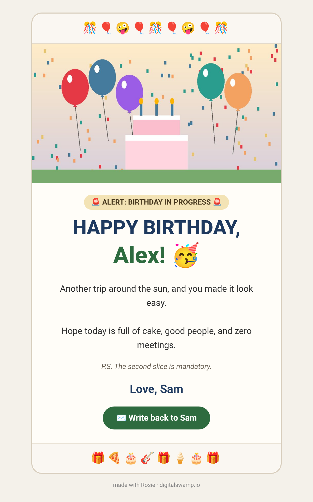

### Heartfelt

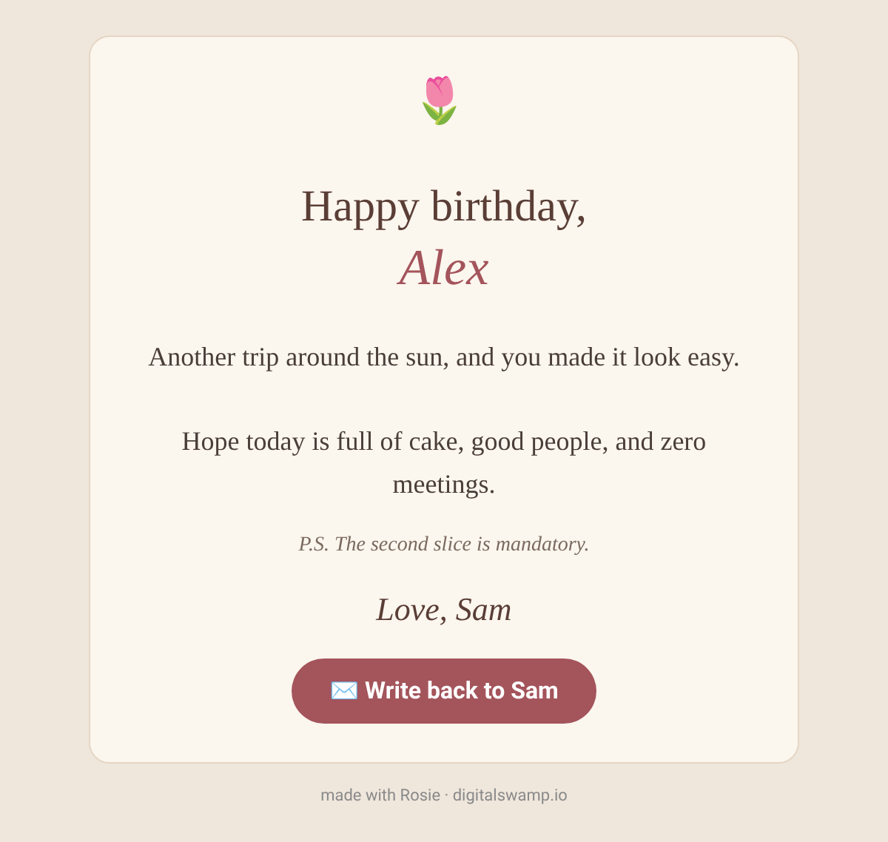 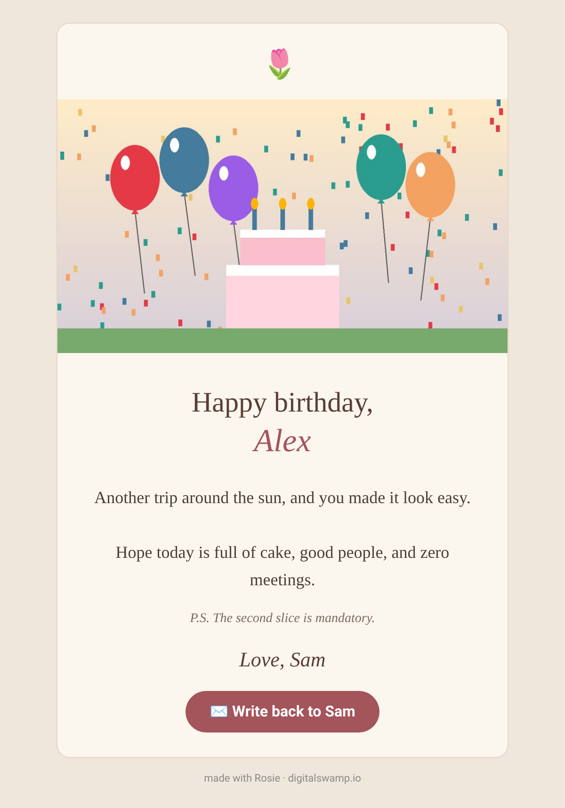

### Kid/Fun

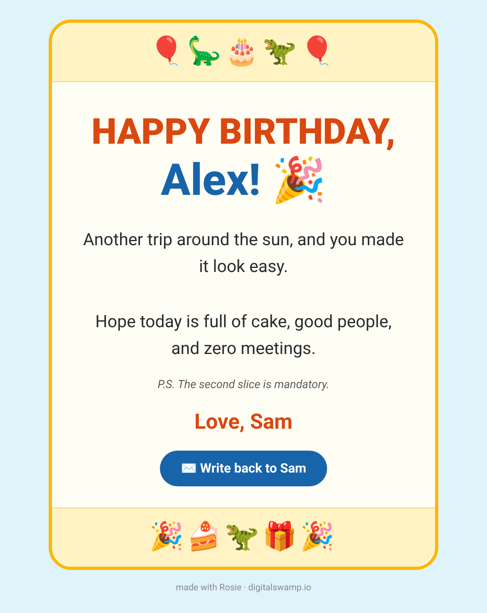 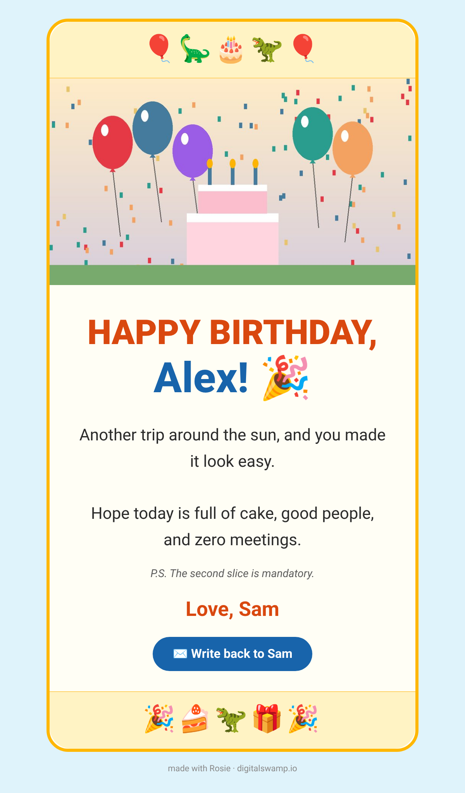

### Classic

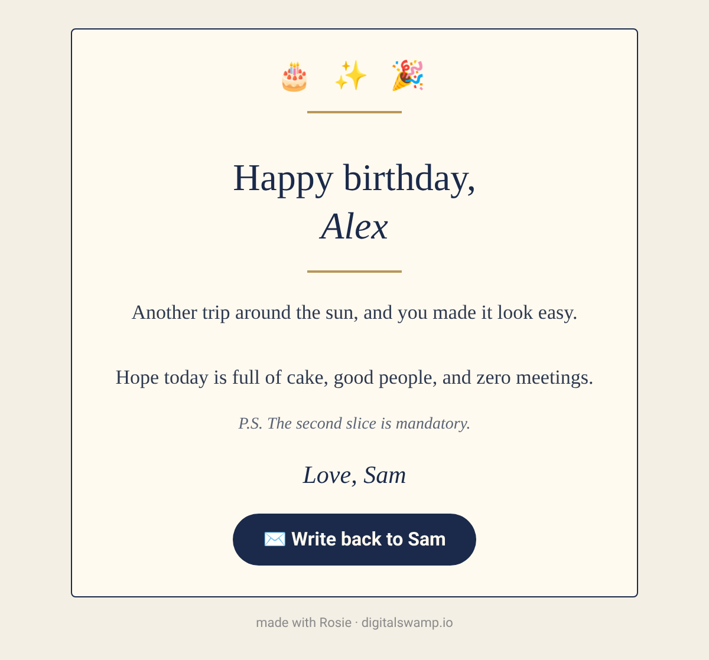 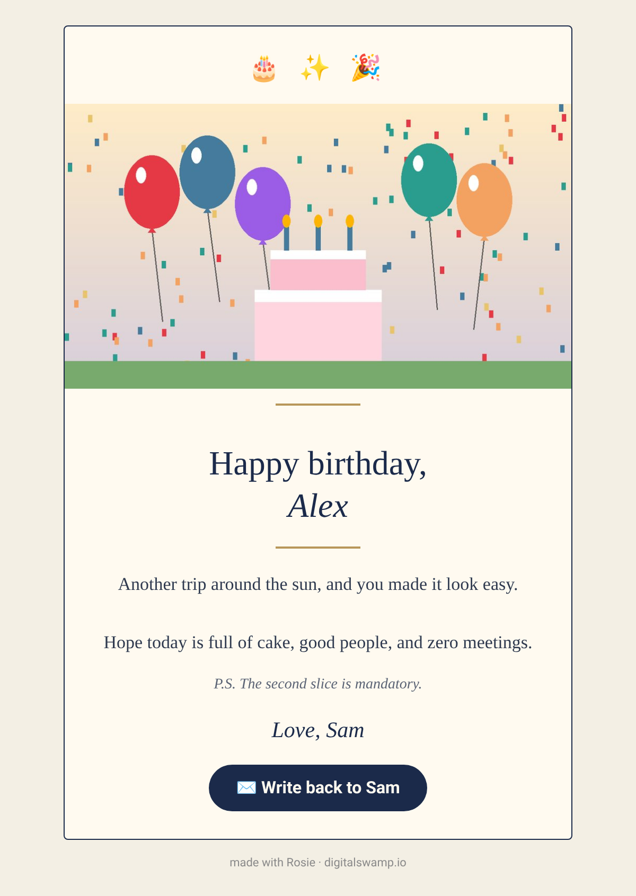

Every style also has `-dark.png` and `-art-dark.png` previews in [`previews/`](previews/). They simulate a mail app that force-inverts colors in dark mode. Emoji look odd in that simulation only; real mail apps don't invert emoji.

## Quick start

Requires Python 3.8+.

```bash
pip install -r requirements.txt                  # Pillow (for --art) and playwright (for previews)
python3 -m playwright install chromium           # only needed for preview.py

# Fill the Classic template with the example values and the example art:
python3 tools/fill.py classic previews/example-values.json out/alex-classic \
  --from you@example.com --to alex@example.com --subject "Happy birthday, Alex" \
  --art previews/example-art-1280x720.png

# Render a PNG preview (add --dark to simulate forced dark mode):
python3 tools/preview.py out/alex-classic.html out/alex-classic.png

# Lint templates or filled cards for email safety:
python3 tools/check_email_safety.py templates/*.html out/alex-classic.html
```

(`fill.py` doesn't create folders, so run `mkdir -p out` first.)

## Slots

Each slot is a `{{TOKEN}}` in both the `.html` and the `.txt` file. Values come from a JSON file (see [`previews/example-values.json`](previews/example-values.json)).

| Slot | Required | Notes |
|---|---|---|
| `{{PREHEADER}}` | yes | Inbox preview text, hidden in the body. Keep it to about 40–90 characters. |
| `{{RECIPIENT_NAME}}` | yes | First name (or nickname) only. |
| `{{HEADLINE}}` | yes | For example `Happy birthday,`. The name is printed on the next line. Funny and Kid/Fun print the headline in uppercase; the name is printed as written in every style. |
| `{{VERSE}}` | yes | 2–4 short sentences, as plain text. A blank line becomes `<br><br>`. The text is HTML-escaped. |
| `{{PS}}` | optional | Text after `P.S.`. Don't include "P.S." yourself. If it's empty, the row is removed. |
| `{{SIGNOFF}}` | yes | For example `Love, Sam 🎉` or `With love, Sam`. |
| `{{SIGNATURE_IMG_URL}}` | optional | A hosted `https://` PNG of the sign-off in a handwriting-style font. Its alt text is `{{SIGNOFF}}`. When it's set, it replaces the text sign-off. |
| `{{ENVELOPE_IMG_URL}}` | optional | A "closed envelope" header image above the card that the reader scrolls past, with a "scroll down to open ↓" hint. If it's an animated GIF, frame 1 must be a finished design, because Outlook shows only frame 1. If it's empty, the block is removed. |
| `{{REPLY_MAILTO}}` | yes | A `mailto:` link for the **Write back to `{{SENDER_NAME}}`** button, for example `mailto:sam@example.com?subject=Re%3A%20your%20card`. |
| `{{SENDER_NAME}}` | yes | For example `Sam`. It's used on the button. |
| `{{ART_SRC}}` | optional | The card's picture: a full-width image above the headline. Either `cid:art.jpg` (set for you by `fill.py --art`) or a hosted `https://` URL. If it's empty, the block is removed. See [Art](#art). |
| `{{ART_ALT}}` | required when `ART_SRC` is set | A few words describing the picture, for example `Balloons and a birthday cake`. It's the image's alt text, and the `.txt` gets a `(Picture: …)` line. |
| `{{BADGE}}` | optional | The small rounded label above the headline, for example `🚨 ALERT: BIRTHDAY IN PROGRESS 🚨`. Funny shows it whenever it's set; the other styles show it only when a style file or `--badge` turns it on (see [Customize your card](#customize-your-card)). If it's empty, the badge is removed. |
| `{{BUTTON_TEXT}}` | optional | The reply button's label after ✉️. Empty means `Write back to {{SENDER_NAME}}`. Usually set with `button_text`. |
| `{{EMOJI_TOP}}`, `{{EMOJI_BOTTOM}}`, `{{EMOJI_TOP_TXT}}`, `{{NAME_SUFFIX}}`, `{{NAME_SUFFIX_TXT}}` | filled by `fill.py` | The emoji strips and what follows the name. Their defaults are in the template's `STYLE` marker; change them with `emoji_top`, `emoji_bottom` and `name_suffix`. |
| `{{COLOR_BG}}`, `{{COLOR_CARD}}`, `{{COLOR_TEXT}}`, `{{COLOR_ACCENT}}`, `{{COLOR_BUTTON}}` | optional | Color overrides; empty means the style's own palette. See [Custom colors](#custom-colors). |

### Markers

- `<!--IF:SLOT--> … <!--/IF:SLOT-->`: the block is kept only when that slot has a value.
- `<!--IFNOT:SLOT--> … <!--/IFNOT:SLOT-->`: the block is kept only when that slot is empty.
- `<!--COLORS:{…}-->`: the style's default palette as JSON (plus the fixed headline, sign-off, P.S. and button-label colors used for contrast checks). `fill.py` reads it for the `COLOR_*` defaults and removes it.
- `<!--STYLE:{…}-->`: the template's own fonts, sizes, corner radius, border, alignment, emoji and name ending as JSON. `fill.py` reads it for the `{{S_*}}` layout tokens (filled from a checked list, never from free text) and the emoji/name-ending defaults, and removes it.
- `<!--IF:ART_TOP-->`, `<!--IF:ART_SIDE-->`, `<!--IF:ART_BOTTOM-->`: the three picture positions. `fill.py` keeps exactly one when there's a picture (`art_position`, default top).
- `<!--FOOTER--> … <!--/FOOTER-->`: the small grey line "made with Rosie · digitalswamp.io". Pass `--no-footer` to drop it.

`tools/fill.py` resolves every marker. A filled file contains no markers and no `{{…}}`.

## Custom colors

Five colors can be overridden per card. Anything left empty keeps the style's palette, so a card with no overrides is byte-for-byte the same as the stock template.

| Slot | Colors | Funny | Heartfelt | Kid/Fun | Classic |
|---|---|---|---|---|---|
| `COLOR_BG` | page background around the card | `#f4f1ea` | `#efe6dc` | `#dff3fb` | `#f3efe4` |
| `COLOR_CARD` | card background | `#fffdf8` | `#fbf6ee` | `#fffef5` | `#fffaf0` |
| `COLOR_TEXT` | verse text | `#333333` | `#4a3f38` | `#2b2b2b` | `#2f3a4f` |
| `COLOR_ACCENT` | the recipient's name | `#2e6b3f` | `#a4545b` | `#1864ab` | `#1b2a4a` |
| `COLOR_BUTTON` | "Write back" button | `#2e6b3f` | `#a4545b` | `#1864ab` | `#1b2a4a` |

Borders, emoji strips, badge, rules, headline, sign-off and P.S. keep the style's colors.

- **How to pass them:** `--colors '{"COLOR_ACCENT":"#c0392b"}'` or `--colors file.json`. `COLOR_*` keys inside the values JSON work too; `--colors` wins.
- **Validation:** only the five slot names are accepted, and each value must be `#rgb` or `#rrggbb`. Anything else stops `fill.py`.
- **Contrast warning:** when overrides are given, `fill.py` prints a `warning:` (it still writes the card) for any touched pair below WCAG 4.5:1: verse on card, button label on button, sign-off and P.S. on card. The large name and headline lines use 3:1, as does the footer grey on the page background. It also warns about pure `#000000`/`#ffffff`, which behave badly under dark-mode inversion. Take the warning seriously and pick a darker or lighter shade rather than sending a hard-to-read card.
- **Example:** [`previews/example-colors.json`](previews/example-colors.json) (red accent and button, pale blue page) rendered on the Classic style:

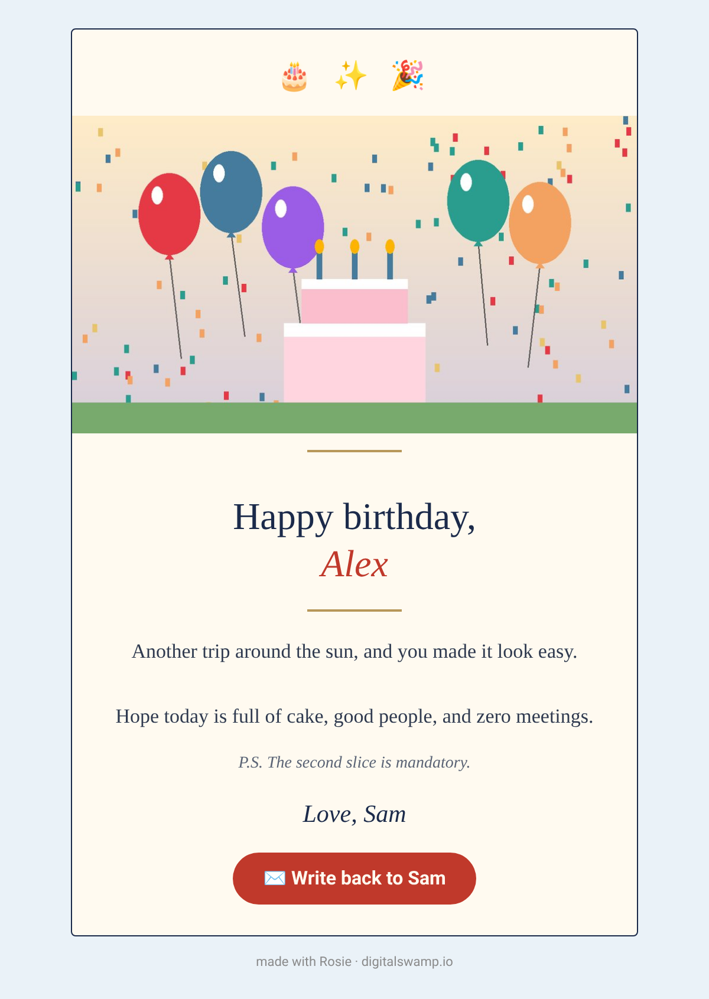

## Customize your card

Colors are only the start. You can also change the card's layout, add your own picture, pick a font, change the greeting and sign-off wording, and save all of it as a **style file** you reuse for one person or for every card.

Nothing changes unless you ask for it. With no style file and no style flags, `fill.py` writes exactly the same bytes as before.

### Try it

```bash
# A ready-made style file (base template, colors, fonts, layout, wording and picture in one place):
mkdir -p out
python3 tools/fill.py --style examples/my-style.json previews/example-values.json out/alex-mine --from you@example.com

# Or change one thing at a time with flags:
python3 tools/fill.py classic previews/example-values.json out/alex-letter --from you@example.com \
  --font typewriter --align left --corner-radius 0 --border none --no-emoji \
  --greeting "Dear" --name-suffix "," --signoff "Yours, {sender}"
```

### Style files

A style file is a small JSON file. Every key is optional; leave one out and the template keeps its own look. Here is [`examples/my-style.json`](examples/my-style.json):

```json
{
  "base": "heartfelt",
  "colors": {"COLOR_ACCENT": "#8a3b5c", "COLOR_BUTTON": "#8a3b5c", "COLOR_BG": "#f7f1f6"},
  "font": "rounded",
  "body_font": "friendly-sans",
  "art": "../previews/example-art-1280x720.png",
  "art_alt": "Balloons and a birthday cake with three candles",
  "art_source": "own-art",
  "art_position": "side",
  "align": "center",
  "corner_radius": 24,
  "border": "thick",
  "border_color": "#d9b8cc",
  "badge": "🌸 just for you 🌸",
  "emoji_top": "🌸 🌷 🌸",
  "footer": true,
  "greeting": "Happy birthday, dear",
  "signoff": "All my love, {sender}",
  "button_text": "Send {sender} a note"
}
```

- **Use it:** `--style path/to/file.json`, or `--style NAME` for `styles/NAME.json`. If the style file sets `base`, you can leave the style name off the command (`fill.py --style mine.json VALUES.json OUT`).
- **Per person:** save one file per person in `styles/` (for example `styles/grandma.json`) and pass `--style grandma` when you make their card.
- **Start from another style:** `"extends": "my-style.json"` loads that file first, then applies this one's keys on top. [`examples/grandma.json`](examples/grandma.json) does this.
- **A default for every card:** if `styles/default.json` exists, it's applied to every card first. Skip it for one card with `--no-default-style`.
- **Notes for yourself:** keys starting with `_` (like `"_about"`) are ignored.
- **Who wins:** template look < `styles/default.json` < `--style` file (after whatever it extends) < the individual flags. For colors, `--colors` wins over a style file's `colors`. A style's `greeting`, `signoff`, `button_text`, `badge` and `art_alt` replace the same text in the values JSON.
- **Mistakes stop the run:** an unknown key, a wrong type, a value that isn't on the list, or an unsafe font stops `fill.py` with a message saying which one, before anything is written.

### Every option

| Option (style file) | Flag | What it does | Values | If you leave it out |
|---|---|---|---|---|
| `base` | the `STYLE` argument | Which template to start from. | `funny`, `heartfelt`, `kidfun`, `classic` | You name the style on the command line. |
| `extends` | | Load another style file first. | a path or a name in `styles/` | |
| `colors` | `--colors` | The five color slots. See [Custom colors](#custom-colors). | `{"COLOR_ACCENT": "#c0392b", …}` | The template's palette. |
| `font` | `--font` | Font for all the text on the card. | a menu name (below), `style`, or a stack of email-safe fonts | The template's fonts. |
| `heading_font` | `--heading-font` | Just the headline and the name. | same as `font` | `font` |
| `body_font` | `--body-font` | Just the verse and the P.S. | same as `font` | `font` |
| `signoff_font` | `--signoff-font` | Just the sign-off. | same as `font` | `font` |
| `art_position` | `--art-position` | Where the picture goes: across the **top**, a small 150 px picture at the **side** of the headline, at the **bottom** above the sign-off (with rounded corners and a margin), or **none** (no picture even if one was given). | `top`, `side`, `bottom`, `none` | `top` |
| `align` | `--align` | Center everything, or line the headline, verse, sign-off and button up on the left like a letter. | `center`, `left` | `center` |
| `corner_radius` | `--corner-radius` | How round the card's corners are, in pixels. `0` is square. | `0`–`40` | The template's (4–28 px). |
| `border` | `--border` | The card's outline. | `style` (the template's), `none`, `thin` (1 px), `medium` (2 px), `thick` (4 px) | `style` |
| `border_color` | `--border-color` | The outline's color. | `#rgb` or `#rrggbb` | The template's border color. |
| `badge` | `--badge TEXT`, `--no-badge` | The small rounded label above the headline. Text turns it on (in any style, not just Funny); `false` turns it off; `true` uses the `BADGE` text from the values JSON. | text up to 60 characters, `true`, `false` | Funny shows `BADGE` from the values; the other styles show no badge. |
| `emoji` | `--no-emoji` | `false` removes the emoji strips at the top and bottom. | `true`, `false` | `true` |
| `emoji_top` | `--emoji-top` | Your own top emoji line (also the first line of the text version). `""` removes it. | up to 60 characters | The template's emoji. |
| `emoji_bottom` | `--emoji-bottom` | Your own bottom emoji strip (any style). `""` removes it. | up to 60 characters | The template's (Funny and Kid/Fun only). |
| `name_suffix` | `--name-suffix` | What follows the name, in the card and in the text version: `!`, `,`, `! 🥳`, or `""` for nothing. | up to 12 characters | Funny `! 🥳`, Kid/Fun `! 🎉`, others nothing. |
| `uppercase_headline` | `--uppercase-headline`, `--no-uppercase-headline` | Print the headline in capitals or as written. | `true`, `false` | Funny and Kid/Fun: capitals. Others: as written. |
| `greeting` | `--greeting` | The headline line above the name, for example `Happy birthday,` or `Dear`. | up to 60 characters | `HEADLINE` from the values JSON. |
| `signoff` | `--signoff` | The closing line, for example `All my love, {sender}`. | up to 80 characters | `SIGNOFF` from the values JSON. |
| `button_text` | `--button-text` | The reply button's label (the ✉️ stays in front). | up to 40 characters | `Write back to {sender}` |
| `footer` | `--no-footer` | `false` drops the small "made with Rosie" line. | `true`, `false` | `true` |
| `art` | `--art` | Your picture: a JPEG or PNG on your computer. A relative path is read from the style file's folder. | a file path | No picture. |
| `art_alt` | `--art-alt` | A few words describing the picture, for people who can't see it. Required with a picture. | up to 140 characters | `ART_ALT` from the values JSON. |
| `art_source` | | Where the picture came from, as a reminder of the picture rules below. `generated` prints a reminder that it must not show a real person. | `own-photo`, `own-art`, `generated`, `licensed` | |

In `greeting`, `signoff`, `button_text` and `badge`, `{name}` becomes the recipient's name and `{sender}` becomes yours (`RECIPIENT_NAME` and `SENDER_NAME` from the values JSON). The text version of the card always gets the same greeting, name ending, sign-off, button label, badge and top emoji as the HTML.

### Font menu

Many mail apps, including Gmail and Outlook for Windows, don't load web fonts, so every choice is a list of fonts that are already on people's computers and phones, ending with a generic fallback. The reader sees the first one their device has.

| Name | Looks like | Stack |
|---|---|---|
| `classic-serif` | Georgia, a bookish serif | `Georgia, 'Times New Roman', Times, serif` |
| `clean-sans` | the system font (San Francisco, Segoe UI, Roboto) | `-apple-system, BlinkMacSystemFont, 'Segoe UI', Roboto, Helvetica, Arial, sans-serif` |
| `elegant-serif` | Palatino, a graceful serif | `'Palatino Linotype', Palatino, 'Book Antiqua', Georgia, serif` |
| `friendly-sans` | Verdana, wide and easy to read | `Verdana, Geneva, Tahoma, sans-serif` |
| `modern-sans` | Trebuchet, a little playful | `'Trebuchet MS', 'Lucida Grande', 'Lucida Sans Unicode', Arial, sans-serif` |
| `rounded` | rounded letters where available | `'Arial Rounded MT Bold', 'Trebuchet MS', ui-rounded, 'Helvetica Rounded', Verdana, sans-serif` |
| `typewriter` | an old typewriter | `'Courier New', Courier, 'American Typewriter', monospace` |

You can also give your own stack, such as `"Garamond, Georgia, serif"`. `fill.py` and the lint accept it only if every font is on the email-safe list in `tools/safe_fonts.py` and it ends with `serif`, `sans-serif` or `monospace`. The badge and the button keep the clean sans font so they stay crisp.

Rounded letters show on Macs, iPhones and PCs with Microsoft Office (Arial Rounded); other devices fall back to Trebuchet or Verdana. Previews made on Linux show the fallback.

### Your own picture

- **Use your own photos or art, or pictures you have the right to use.** A photo of a real person goes on a card only if it's your own photo and you chose it. Generated art must never show a real person's face or likeness.
- Any size works. `fill.py` shrinks it to 960 px wide (300 px for `side`, which shows at 150 px) and saves a JPEG under 300 KB, then embeds it inline as `cid:art.jpg` (see [Art](#art)). It warns if the picture is too small to look sharp.
- `art_alt` is required. Describe what's in the picture in a few words.
- `side` works best with a square-ish or landscape picture; the headline and name are printed 30% smaller next to it so long names still fit on a phone.

### What the lint checks for custom cards

`tools/check_email_safety.py` now also fails a card for: fonts outside the email-safe list or a stack without a generic fallback; an image with empty alt text or without a `width` attribute (Outlook needs one), or wider than 600; art that isn't sized email-safely (`width:100%; max-width:480px`, or a fixed width with `max-width:100%` for the side picture); text below 2.5:1 contrast on its background; an HTML body over 100 KB (Gmail clips messages at 102 KB); and an inline art file (`OUT.art.jpg`) over 300 KB (`--max-art-kb`) or wider than 960 px. It warns, without failing, about text between 2.5:1 and 4.5:1 (fine for big headlines, hard to read in small print) and about leftover `{{TOKENS}}`.

### Examples

| File | What it shows |
|---|---|
| [`examples/my-style.json`](examples/my-style.json) | Heartfelt base, rounded headline font, Verdana body, side picture, thick pink border, a badge, custom wording. |
| [`examples/typewriter-letter.json`](examples/typewriter-letter.json) | Classic base as a plain letter: typewriter font, left-aligned, square corners, no border, no emoji, no picture, no footer. |
| [`examples/kid-rocket.json`](examples/kid-rocket.json) | Kid/Fun with the picture at the bottom, space emoji, `!!! 🚀` after the name, headline as written. |
| [`examples/grandma.json`](examples/grandma.json) | A per-person file that `extends` my-style.json and changes the greeting, the fonts and the picture position. |

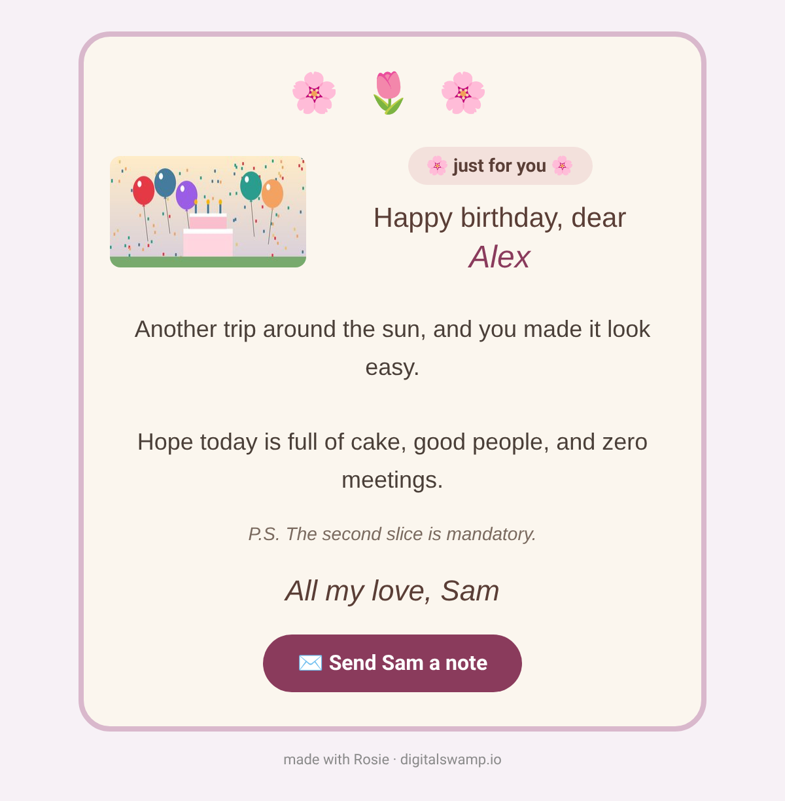 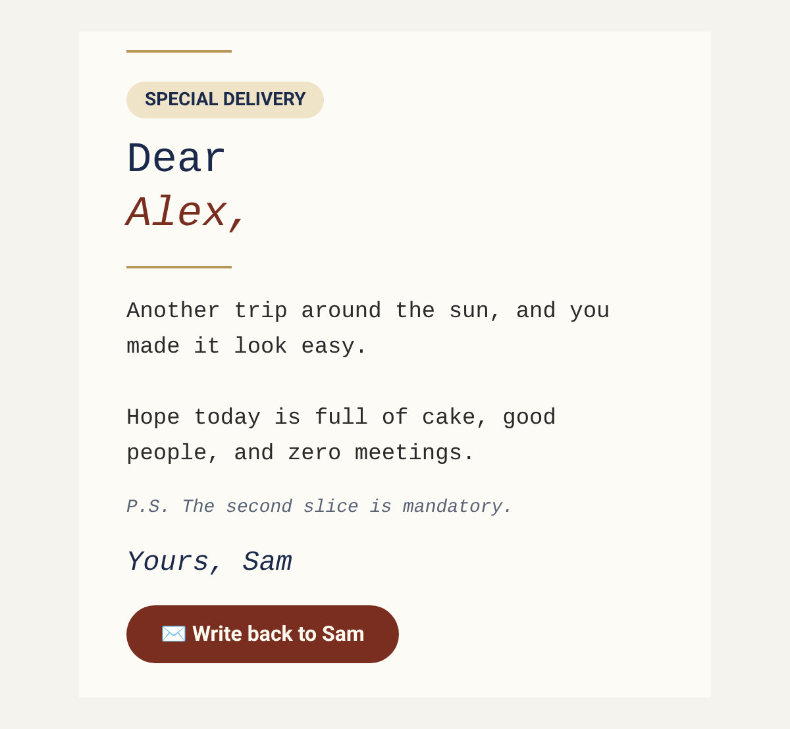 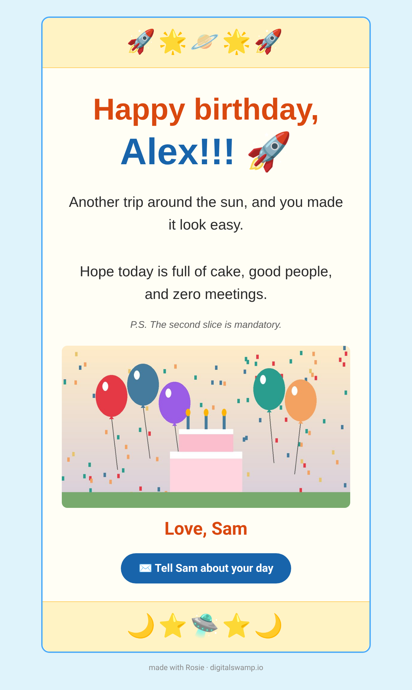

### Limits

- Border, rule, emoji-strip, badge, headline, sign-off and P.S. colors still come from the template (only `border_color` and the five color slots change).
- The side picture is a fixed 150 px column, so on very narrow screens the headline wraps sooner.
- Templates you build yourself without the `STYLE` marker still take colors and wording; the layout and font options are skipped with a warning.

## Art

Each template has an optional art block right above the headline: a full-width image (`width:100%; max-width:480px`, with an HTML `width` set to the card's inner width for Outlook). It's removed when `ART_SRC` is empty, so cards without art are unchanged.

### Inline CID attachment (default)

`fill.py --art IMAGE` embeds the picture as an **inline CID attachment** named `art.jpg`, and the HTML references it as ``. This needs no image hosting and shows even when the reader's mail app blocks remote images.

`fill.py ... --art picture.png` resizes the image to at most 960 px wide (`--art-width`), saves a JPEG at the highest quality that fits under 300 KB (`--art-max-kb`; quality steps down from 85 to 40), and writes:

- `OUT.html` / `OUT.txt`, with `ART_SRC` set to `cid:art.jpg`
- `OUT.art.jpg`: the compressed image (a 1280×720 PNG becomes 960×540; compare [`previews/example-art-1280x720.png`](previews/example-art-1280x720.png) and [`previews/example-art-960.jpg`](previews/example-art-960.jpg))
- `OUT.eml`: a complete MIME message: `multipart/alternative` → `text/plain` + `multipart/related` → (`text/html`, `image/jpeg` with `Content-ID: <art.jpg>`, inline). Open it in a mail app or send it through anything that accepts raw MIME.
- `OUT.send.json`: `to`, `subject`, `from`, `body` (text), `htmlBody`, and `attachments: [{content (base64), filename: "art.jpg", mimeType: "image/jpeg", inline: true}]`, for mail APIs that take inline attachments.

If you send it yourself, don't rename the attachment: the `cid:art.jpg` in the HTML must match the filename/Content-ID `art.jpg`.

### Hosted image (alternative)

Put a hosted `https://` URL in `ART_SRC` in the values JSON and leave out `--art`. It only shows when the reader's mail app loads remote images. Use a static host that serves the image file directly; avoid share links that redirect to a sign-in page, and never use a host that adds tracking or redirects.

Make your own art at any size (a 16:9 image such as 1280×720 works well). Please don't use real people's faces or likenesses.

## Running the tools

### `tools/fill.py`

```
python3 tools/fill.py STYLE VALUES.json OUT_BASENAME --from ADDR [options]
python3 tools/fill.py --template PATH.html VALUES.json OUT_BASENAME --from ADDR [options]
```

- `STYLE` is `funny`, `heartfelt`, `kidfun` or `classic` (reads `templates/STYLE.html` and `.txt`). Or pass any template with `--template PATH.html` (its text twin is the same path ending `.txt`, or pass `--text-template`).
- `--from ADDR` is **required**, or set the `ROSIE_FROM` environment variable. It's used for the `From` header and for the `Message-ID` domain in the `.eml`.
- `--to ADDR`, `--subject TEXT`: optional headers for `OUT.eml` / `OUT.send.json`.
- `--no-footer`: drop the "made with Rosie" line.
- `--colors JSON|FILE`: color overrides (see above).
- `--art IMAGE [--art-width 960] [--art-max-kb 300]`: inline art (needs Pillow).
- `--style FILE|NAME`, `--no-default-style`, and the style flags (`--font`, `--heading-font`, `--body-font`, `--signoff-font`, `--art-position`, `--align`, `--corner-radius`, `--border`, `--border-color`, `--badge`, `--no-badge`, `--emoji-top`, `--emoji-bottom`, `--no-emoji`, `--name-suffix`, `--uppercase-headline`, `--no-uppercase-headline`, `--greeting`, `--signoff`, `--button-text`, `--art-alt`): see [Customize your card](#customize-your-card). With a style file that sets `base`, leave out `STYLE`.

It writes `OUT.html` and `OUT.txt` (plus `.art.jpg`, `.eml` and `.send.json` with `--art`). It refuses to overwrite any existing file, fails on an empty required slot, and fails on any unfilled slot or marker.

### `tools/preview.py`

```
python3 tools/preview.py IN.html OUT.png [--dark] [--art FILE]
```

Renders a filled card to a PNG at 600 px wide (2× scale) with headless Chromium. It needs `playwright` and a browser (`python3 -m playwright install chromium`). To use an installed Chrome or Chromium instead, set `ROSIE_CHROME=/path/to/chrome`. If the card uses `cid:art.jpg`, the sibling `IN.art.jpg` written by `fill.py --art` is shown in its place (or pass `--art FILE`). `--dark` simulates a mail app that force-inverts colors.

### `tools/check_email_safety.py`

```
python3 tools/check_email_safety.py [--max-art-kb 300] FILE.html [...]
```

Lints templates or filled cards and exits 1 on any failure: style blocks, scripts, event handlers, CSS animation, web fonts, tracking params, redirectors, 1×1 pixels, non-https links or images, images without alt or with empty alt, images without a `width` attribute or wider than 600, art that isn't sized email-safely, fonts outside the email-safe list, text below 2.5:1 contrast, HTML over 100 KB, and inline art over 300 KB or 960 px. It warns about text below 4.5:1 and leftover `{{TOKENS}}`. See [What the lint checks for custom cards](#what-the-lint-checks-for-custom-cards).

### `tools/build_templates.py`

Regenerates the four templates in `templates/` from their palettes. You only need it if you change a style.

## Email-safety rules these templates follow

- **Full head:** `lang="en"`, `meta charset="utf-8"`, viewport, and `x-apple-disable-message-reformatting`.
- **Dark mode meta:** `color-scheme` and `supported-color-schemes` set to `light dark`. Every text color sits on its own solid `bgcolor`, with no pure black or white, so mid-tone accents stay readable when a client inverts colors. The footer grey `#8a8a8a` reads on both.
- **Hidden preheader** div (`display:none; mso-hide:all`).
- **Tables for layout:** an outer table at 100% width, then an inner table at `width:100%; max-width:480px`.
- **MSO wrapper:** Outlook gets a conditional `<!--[if mso]>` `<table width="480">` wrapper, since it ignores `max-width`.
- **Inline CSS only**, with no `<style>` block and no external CSS. Fonts are system stacks only (sans: `-apple-system, BlinkMacSystemFont, 'Segoe UI', Roboto, Helvetica, Arial`; serif: `Georgia, 'Times New Roman'`; the [font menu](#font-menu) adds a few more installed-font stacks). No web fonts.
- **No JavaScript** and no CSS animation. Decoration is emoji; the only content images are the optional art, signature and envelope images.
- **No tracking:** no tracking pixels, open or click tracking, or link redirectors.

## How Rosie uses it

Rosie (the Grok Bot) follows a simple loop with its owner: **draft** a card with `fill.py` and show the preview PNG plus the plain-text version, **test-send** it to the owner's own address to check it in real mail apps, wait until the **owner approves**, then **send** it once, on the day. Rosie never sends a card without approval and never posts anywhere.

## Files

```
templates/   funny, heartfelt, kidfun, classic (.html + .txt)
tools/       fill.py, preview.py, check_email_safety.py, build_templates.py,
             safe_fonts.py (font menu + email-safe font list)
examples/    example style files (my-style, typewriter-letter, kid-rocket, grandma)
styles/      your own style files (git-ignored): NAME.json, default.json
previews/    example renders (plain, -art, -dark, -art-dark, classic-override, custom-*),
             example-values.json, example-colors.json, example art (PNG + compressed JPEG)
```

## Beta known issues

- Inline art has been checked in Gmail (web and phone) only. Outlook, Apple Mail/iCloud, Yahoo, and the bot-inbox path are untested, so please report what you see.
- The bot-inbox send path has no Reply-To header and may not show inline (cid) art. Rosie adds the owner's reply address as a line on the card, and falls back to a hosted art link or no art.

## License

MIT. See [LICENSE](LICENSE).
